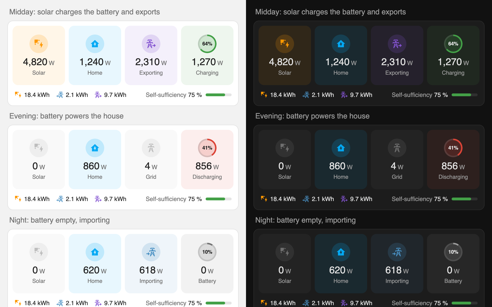
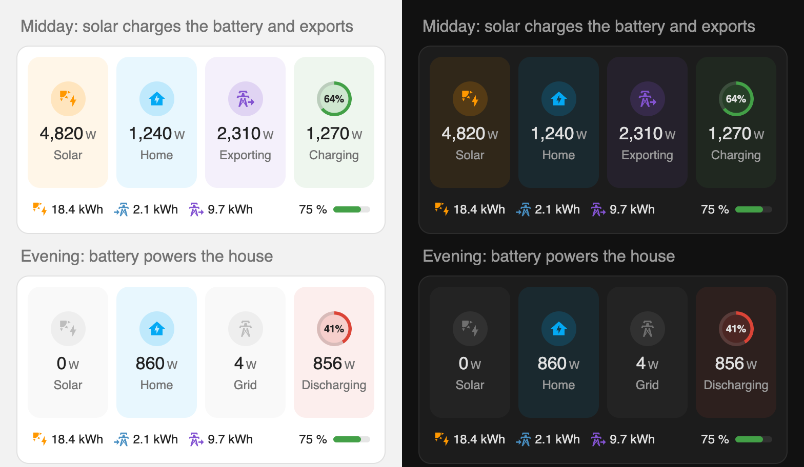
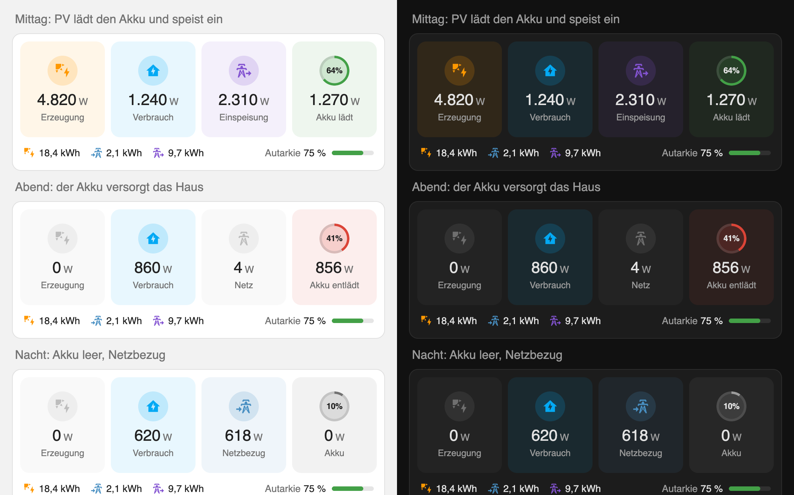

<p align="center">
  <a href="https://my.home-assistant.io/redirect/marketplace_repository/?owner=yannick80&repository=ha-card-for-alphaess&category=plugin">
    
  </a>
</p>
<p align="center">
  <a href="https://github.com/yannick80/ha-card-for-alphaess/releases/latest">
    
  </a>
  <a href="https://www.home-assistant.io">
    
  </a>
  <a href="https://github.com/yannick80/ha-card-for-alphaess/actions/workflows/validate.yml">
    
  </a>
  <a href="LICENSE">
    
  </a>
</p>

# Card for AlphaESS Modbus

A compact Home Assistant dashboard card for AlphaESS inverters connected through [AlphaESS Modbus TCP](https://github.com/senalse/ha-alphaess-modbus).
Pick the inverter and the card shows, in one tile, where your power is flowing right now and what today looks like.



<!-- ha-marketplace:exclude-start -->
**Contents:**
[What you get](#what-you-get) ·
[What the card shows](#what-the-card-shows) ·
[Before you start](#before-you-start) ·
[Installation](#installation) ·
[Add the card](#add-the-card) ·
[Options](#options) ·
[Troubleshooting & FAQ](#troubleshooting--faq) ·
[For developers](#for-developers) ·
[Credits](#credits)
<!-- ha-marketplace:exclude-end -->

## What you get

- **One card instead of eight.** Solar, home, grid and battery right now, plus today's energy, in a full-width card three rows high.
- **Always positive numbers.** The direction is in the label and the colour: *Importing* or *Exporting*, *Charging* or *Discharging*.
- **Battery state of charge** as a ring around the battery tile.
- **Self-sufficiency today**, calculated from the integration's daily energy sensors.
- **Pick the inverter, not entities.** The card finds the sensors on its own.
- **Your Home Assistant language and number format.** The card's texts are in English and German.
- **Visual editor.** Search for "AlphaESS" in the card picker.
- **No other custom cards needed.** One JavaScript file, no dependencies, no card-mod.
- **Runs on old wall tablets** such as the Shelly Wall Display.

## What the card shows

| Tile | Value | Label and colour |
|---|---|---|
| Solar | current PV production | orange while producing, grey at night |
| Home | current house load | your theme's primary colour |
| Grid | grid power, always positive | **Importing** (blue) / **Exporting** (purple) / **Grid** (grey, idle) |
| Battery | battery power, always positive; state of charge in the ring | **Charging** (green) / **Discharging** (red) / **Battery** (idle) |

Below the tiles: today's solar generation, grid import and grid export, and today's self-sufficiency (the share of your consumption that did not come from the grid).
Power below the idle threshold (10 W by default) counts as idle, so the labels do not flicker around zero.

The card is fixed to the full width (12 columns) and 3 rows of a sections dashboard. On narrower screens the labels in the bottom row give way to icons:



<details>
<summary>German interface (Deutsch)</summary>



</details>

## Before you start

- [ ] **Home Assistant 2024.12 or newer.**
- [ ] **[AlphaESS Modbus TCP](https://github.com/senalse/ha-alphaess-modbus) is installed and your inverter shows up as a device** under **Settings** > **Devices & services** > **AlphaESS Modbus TCP**.
  The card only reads the integration's sensors. It does not talk to the inverter itself and does not work with other AlphaESS integrations.

<!-- ha-marketplace:exclude-start -->
## Installation

### Home Assistant 2026.11 and newer (Marketplace)

**One click:** select this button, then confirm in your Home Assistant.

[](https://my.home-assistant.io/redirect/marketplace_repository/?owner=yannick80&repository=ha-card-for-alphaess&category=plugin)

**Or by hand:**

1. In Home Assistant, go to **Settings** > **Marketplace**.
2. In the upper-right corner, select **Add from link**.
3. Under **GitHub link**, enter `https://github.com/yannick80/ha-card-for-alphaess`. If Home Assistant asks for the type, choose **Dashboard**.
4. Open Card for AlphaESS Modbus and select **Install**.
5. Reload the browser (on phones and tablets: close and reopen the app).

### Home Assistant 2026.10 and older (HACS)

[](https://my.home-assistant.io/redirect/hacs_repository/?owner=yannick80&repository=ha-card-for-alphaess&category=plugin)

1. Open **HACS** in the sidebar.
2. Select the three dots in the upper-right corner, then **Custom repositories**.
3. Enter `https://github.com/yannick80/ha-card-for-alphaess`, choose the type **Dashboard**, and select **Add**.
4. Open Card for AlphaESS Modbus and select **Download**.
5. Reload the browser.

### Manual installation

1. Download `alphaess-card.js` from the [latest release](https://github.com/yannick80/ha-card-for-alphaess/releases/latest).
2. Copy it to `config/www/alphaess-card.js` (the `www` folder next to `configuration.yaml`; create it if it does not exist).
3. Go to **Settings** > **Dashboards**, select the three dots, then **Resources**.
   (No **Resources** entry? Turn on **Advanced mode** in your user profile first.)
4. Select **Add resource**, enter `/local/alphaess-card.js?v=0.1.1`, choose **JavaScript module** and select **Create**.
   Raise the `?v=` number after each update so browsers load the new file.
5. Reload the browser.
<!-- ha-marketplace:exclude-end -->

## Add the card

1. Open a dashboard, select the pencil, then **Add card**.
2. Search for **AlphaESS** and pick **Card for AlphaESS Modbus**.
3. Pick your inverter under **Inverter**. That's it; everything else is optional.

In YAML:

```yaml
type: custom:alphaess-card
device: 0123456789abcdef0123456789abcdef
```

Instead of `device` you can name any sensor of the inverter, which is easier when writing YAML by hand:

```yaml
type: custom:alphaess-card
entity: sensor.alphaess_inverter_grid_power
```

## Options

| Option | Default | Description |
|---|---|---|
| `device` | – | Device ID of the inverter |
| `entity` | – | Alternative to `device`: any sensor of the inverter |
| `show_today` | `true` | Show the row with today's energy |
| `show_autarky` | `true` | Show today's self-sufficiency |
| `invert_battery` | `false` | Set to `true` if your battery power is **positive while charging** (see FAQ) |
| `idle_threshold` | `10` | Power in W below which grid and battery count as idle |
| `entities` | found automatically | Use a different sensor for a role, see below |

### Using a different sensor

Map the sensor to its role under `entities`:

```yaml
type: custom:alphaess-card
device: 0123456789abcdef0123456789abcdef
entities:
  pv_power: sensor.my_total_pv_power
```

Roles: `pv_power`, `load_power`, `grid_power`, `battery_power`, `battery_soc`, `pv_today`, `grid_import_today`, `grid_export_today`, `battery_charge_today`, `battery_discharge_today`.
Power sensors may be in W or kW, energy sensors in Wh, kWh or MWh.

## Troubleshooting & FAQ

### "Custom element doesn't exist: alphaess-card"

The browser has not loaded the card. Reload the page, and on phones and tablets close and reopen the Home Assistant app.
After a manual install, check the resource under **Settings** > **Dashboards** > **Resources**: `/local/alphaess-card.js` as **JavaScript module**.

### "No AlphaESS device selected" / "Device not found"

Pick the inverter in the card editor. "Device not found" means the device ID in the YAML no longer exists, for example after the integration was removed and set up again.

### The battery shows "Charging" while it is discharging

AlphaESS inverters report battery power as **negative while charging**, and the card assumes that. If yours is the other way round, set `invert_battery: true` (in the editor: *Battery: positive value = charging*).

### A tile shows "–" or the bottom row is missing

The card shows "–" when the sensor is unavailable or was not found. It finds sensors by their translation key, by the end of their entity ID (for example `…_grid_power`) or by the integration's English sensor name. If you renamed both the entity ID and the name, map the sensor under `entities:`.
Self-sufficiency needs all five daily energy sensors, including *Today's Battery Charged* and *Today's Battery Discharged*.

### The card still shows the old version after an update

Reload the browser with the cache cleared. The browser console (F12) shows the loaded version as `alphaess-card 0.1.1`.

## For developers

The card is a single plain JavaScript file, `dist/alphaess-card.js`, without build step or dependencies. Edit it, copy it to `config/www/` and reload the browser with the cache disabled.

Tests need only Node.js 22:

```sh
node --test tests/*.mjs
```

The preview images in `docs/` are rendered from the real card with a mocked Home Assistant: `sh docs/render-previews.sh` (needs Google Chrome).

See [AGENTS.md](AGENTS.md) for the rules the card follows and [CHANGELOG.md](CHANGELOG.md) for what changed.

**Releasing:** bump `VERSION` in `dist/alphaess-card.js`, move the CHANGELOG entry to the new version, then publish a GitHub release with the tag `vX.Y.Z`. The release workflow checks the version and attaches the file.

## Credits

This card would not exist without **[AlphaESS Modbus TCP](https://github.com/senalse/ha-alphaess-modbus)** by [senalse](https://github.com/senalse), which reads the inverter over the local network and turns its registers into Home Assistant sensors. This card only puts those sensors on a dashboard. If the card is useful to you, please give the integration a ⭐ too.

The icons are from [Material Design Icons](https://pictogrammers.com/library/mdi/), which ship with Home Assistant.

## Disclaimer

This project is independent and not affiliated with, endorsed by, or supported by Alpha ESS Co., Ltd. The name is used only to say which inverters the card is for. The repository contains no AlphaESS logos or other artwork.

## License

[MIT](LICENSE)
